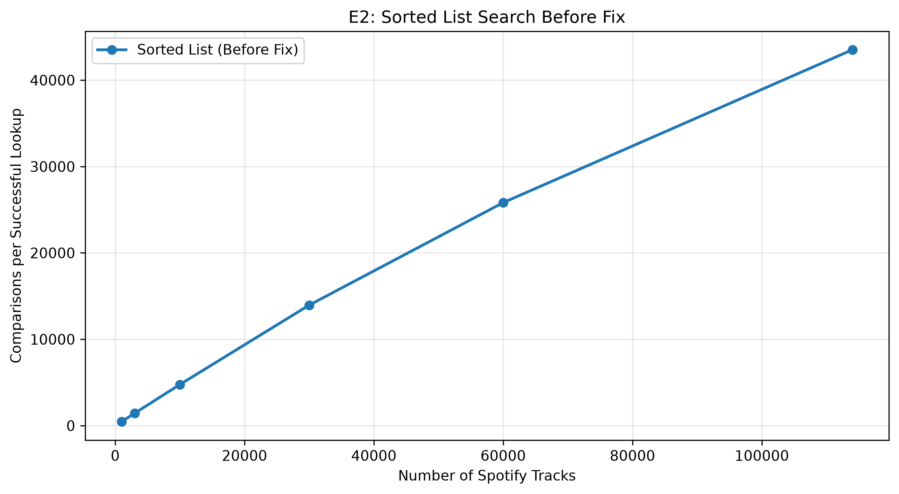
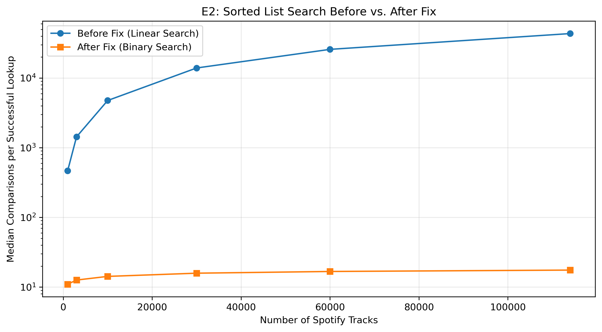

# INC-NN: <one-line title, e.g. "Sorted-List Point Lookup Uses Inefficient Linear Search">

Copy this file to `INC-01.md`, `INC-02.md`, … (one per bug) and fill in every section.
Keep each heading exactly as written; `make check` looks for them.

## Summary

Two or three sentences: what was slow, how much slower, which index and operation, and what fixed it.

Instead of using binary search, the sorted-list indext instead uses seqiuential key lookup to go through the track ids. At 5,226 microseconds, compared with about 1.06 microseconds for the hash table. We fixed the issue by updating the search() method to use the existing _bisect_left() binary-search helper, which made searching much more efficient. 


## Detection

Which experiment and which figure first showed the problem? What made you suspicious?

The performance issue was discovered during Experiment E2 (E2_point_lookup), which measured how efficiently different index implementations searched for Spotify tracks. The sorted-list implementation showed an unexpectedly large number of comparisons as the dataset size increased.

At 1,000 tracks, the sorted list required approximately 466 comparisons per successful lookup. At 114,000 tracks, this increased to approximately 43,515 comparisons per lookup. Since a sorted list should support be able to use binary search rather than checking through so many keys. The results in Figure 1 made us believe that they were using linear search. 


## Expected vs. observed

What should this index cost, according to theory (big-O, and the counters you'd expect)?
What did you measure? Give numbers, e.g. "comparisons per lookup grew from X at n = 1,000 to Y at n = 114,000; theory predicts about log2(n)."

The sorted-list index should use binary search, which has a time complexity of O(log n). However, Experiment E2 showed that comparisons increased from approximately 466 per successful lookup at 1,000 tracks to 43,515 at 114,000 tracks. This suggests that searching is taking O(n) time rather than O(log n).

After correcting the implementation, comparisons increased only from approximately 10.99 to 17.54 over the same range of dataset sizes, which is consistent with logarithmic growth.


## Evidence

Figures and tables (exported from your notebook) that pin down the problem. Use the counters and
`structure_info()`, not only timings. Name the `code_version` of the rows you used.


The evidence comes from Experiment E2 using the Spotify track_id dataset. Each configuration was tested with 500 successful point lookups and five repetitions.

Original code_version: c2406c6

Original session_id: 26d932c399ee

Index: sorted_list

Operation: point_hit

Dataset sizes: 1,000–114,000 records

The results show that comparisons per lookup increased dramatically with the dataset size. At 114,000 records, the sorted list performed approximately 43,515 comparisons per successful lookup, compared with approximately 1.39 for the hash table and 16.90 for the AVL tree.




**Figure 1.** Median comparisons per successful lookup for the original sorted-list implementation in Experiment E2. The number of comparisons increases substantially as the dataset grows, suggesting linear-time searching rather than the expected logarithmic-time binary search.


## Root cause

File, function, and line numbers. Explain in plain English what the code does, what it should do,
and why the difference costs time but still gives correct answers.

The performance issue occurs in indexes/sorted_list.py, in the search() method (lines 48–60 of the original implementation). Instead of using the existing _bisect_left() binary-search helper, the method iterates through the sorted keys one at a time. Although it returns the correct results, this approach requires many unnecessary comparisons and makes searching slower as the dataset grows.

## Fix

The change you made, as a diff (`git diff <before>..<after> -- indexes/`), and the commit hash.

We corrected the search() method in indexes/sorted_list.py by replacing sequential searching with a call to self._bisect_left(key).

The helper uses binary search to locate the position where the requested key should appear. The corrected method then checks whether the key exists at that position and returns the corresponding values if found.

This reduces the search complexity from O(n) to O(log n) without changing the expected search results.

Before - Fix Code Version:** `c2406c6`  
After Fix Code Version:** `3c45879`

```diff
@@ -53,16 +53,15 @@ class SortedListIndex(Index):
     def search(self, key: Any) -> list[Any]:
         # The keys are sorted, so we can stop as soon as we have passed the
         # place where ``key`` would be.
-        comparisons = 0
-        for i, k in enumerate(self._keys):
-            comparisons += 1
-            if k == key:
-                self.stats.comparisons += comparisons
-                return self._values[i]
-            if k > key:
-                break
-        self.stats.comparisons += comparisons
-        return []
+
+        #Use binary search to locate the key
+        pos = self._bisect_left(key)
+
+        if pos < len(self._keys):
+            self.stats.comparisons += 1
+            if self._keys[pos] == key:
+                return self._values[pos]
+        return[]

     def range_search(self, lo: Any, hi: Any) -> list[Any]:
         result: list[Any] = []
```


## Verification

Before/after comparison on the same workload and seeds (same experiment, two `code_version`s).
Confirm `make test` still passes.

After replacing the sequential search with binary search in indexes/sorted_list.py, we ran the test using make test. All 168 tests passed, with 3 skipped, confirming that the corrected implementation passes the existing correctness tests.

We then reran Experiment E2 (E2_point_lookup) with five repetitions to measure the impact of the fix. The original benchmark session was 26d932c399ee, and the corrected benchmark session was 61015bb37183.

The results showed a significant reduction in comparisons per successful lookup. At 114,000 tracks, the original implementation required approximately 43,515 comparisons, compared with only 17.54 comparisons after the fix. This represents approximately 2,481 times fewer comparisons.

Figure 2 demonstrates that the corrected implementation exhibits approximately logarithmic growth rather than linear growth, verifying that binary search successfully resolved the performance issue.



Median comparisons per successful lookup before and after correcting the sorted-list search implementation. The logarithmic y-axis highlights the large reduction in comparisons after the fix.


## Impact on recommendations

Would this bug have changed which index you recommend for any feature (F1–F4)? How?

This bug primarily affects F1: Track page, which requires efficient point lookups using Spotify track IDs.

Before the fix, the sorted list wasn't a good option for this because the number of comparisons incresed so much as more tracks were added. Once it was switched to binary search, this became a much better choice for point lookups. 

However, hash tables remain a strong candidate for F1 because they provide expected O(1) lookup time, compared with O(log n) for a sorted list. Final recommendations should consider actual corrected lookup times, build costs, and memory usage.

The fix does not directly resolve performance issues for F2 (prefix search), F3 (range queries), or F4 (catalog imports). Those features require evidence from their corresponding experiments.


## Why the tests didn't catch it

What kind of test *would* catch a bug like this?
The original implementation passed the correctness tests because sequential searching still returned the correct results. The tests checked whether each search returned the expected values, rather than how efficiently those values were found.

A performance test could have caught this issue by testing searches with different dataset sizes and checking how the number of comparisons changed. 

We could compare the number of for a differing range of tracks. If the search is using binary search correctly, the number of comparissns should stay within a logarithimic bound isntead of growing almost linearly with the number of tracks. 

