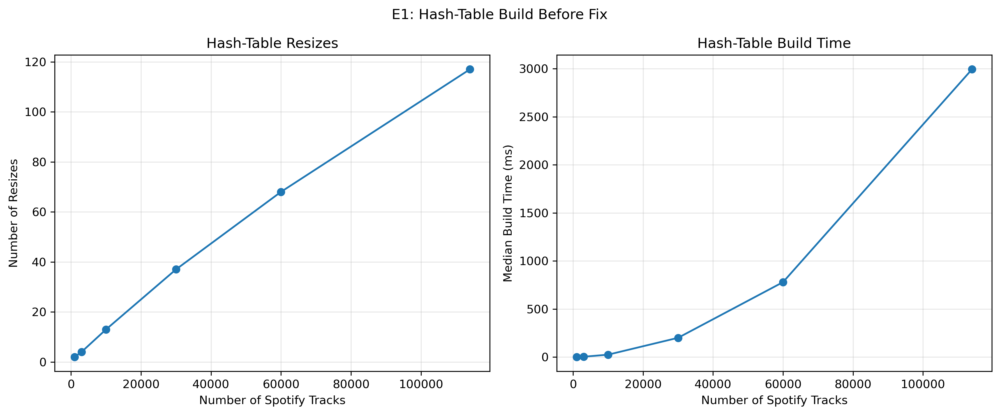

# INC-NN: <one-line title, e.g. "Hash-Table Build Suffers from Excessive Resizing">

Copy this file to `INC-01.md`, `INC-02.md`, … (one per bug) and fill in every section.
Keep each heading exactly as written; `make check` looks for them.

## Summary

Two or three sentences: what was slow, how much slower, which index and operation, and what fixed it.

## Detection

Which experiment and which figure first showed the problem? What made you suspicious?

The performance issue was identified during Experiment E1 (E1_build), which measured the time required to construct different indexes using Spotify track IDs.

The hash-table implementation showed a substantial increase in build time as the dataset grew. At 1,000 tracks, the table resized twice and required approximately 1.10 milliseconds to build. At 114,000 tracks, it resized 117 times and required approximately 2,993.17 milliseconds.

The unusually high number of resizing operations suggested that the hash table was repeatedly rebuilding its internal bucket structure, potentially causing unnecessary work during construction.

## Expected vs. observed

What should this index cost, according to theory (big-O, and the counters you'd expect)?
What did you measure? Give numbers, e.g. "comparisons per lookup grew from X at n = 1,000 to Y at n = 114,000; theory predicts about log2(n)."

The hash-table index is expected to have an average O(1) insertion cost and approximately O(n) total build time when using an efficient resizing strategy.

However, Experiment E1 showed that build time increased significantly as the number of Spotify tracks grew. At 1,000 tracks, construction required approximately 1.10 milliseconds and 2 resizes. At 114,000 tracks, construction required approximately 2,993 milliseconds and 117 resizes.

The large number of resizing operations suggested that the hash table was performing unnecessary work during construction. Each resize requires redistributing existing entries, increasing the overall cost of building the index.

## Evidence

Figures and tables (exported from your notebook) that pin down the problem. Use the counters and
`structure_info()`, not only timings. Name the `code_version` of the rows you used.

The original E1 benchmark used code version `31da8dc`,
session `54f480364efc`, and five repetitions per
dataset size.

At 114,000 tracks, the hash table performed 117 resizes,
with a median build time of approximately 2,993.17 ms.

**Figure 1.** Hash-table resize counts and median build
times as the dataset size increases. The results suggest
substantial overhead from repeated resizing.

## Root cause

File, function, and line numbers. Explain in plain English what the code does, what it should do,
and why the difference costs time but still gives correct answers.

The performance issue occurs in `indexes/hash_table.py`, within the `_grow()` method, around lines 52–60.

The original implementation increases the hash table's capacity by a fixed 1,024 buckets whenever the load factor exceeds its threshold. Each time the table grows, it creates a new bucket array and redistributes all existing entries.

As the dataset becomes larger, this fixed-size growth strategy causes the table to resize repeatedly. Because every resize requires rehashing the existing keys, the cumulative work becomes increasingly expensive.

A more efficient approach is to double the table's capacity during resizing. This reduces how frequently resizing occurs while preserving the hash table's functionality.

## Fix

The change you made, as a diff (`git diff <before>..<after> -- indexes/`), and the commit hash.

## Verification

Before/after comparison on the same workload and seeds (same experiment, two `code_version`s).
Confirm `make test` still passes.

## Impact on recommendations

Would this bug have changed which index you recommend for any feature (F1–F4)? How?

## Why the tests didn't catch it

What kind of test *would* catch a bug like this?
