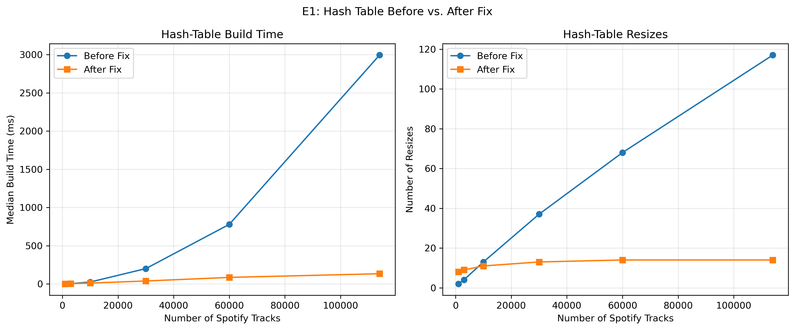

# INC-NN: <one-line title, e.g. "Hash-Table Build Suffers from Excessive Resizing">

Copy this file to `INC-01.md`, `INC-02.md`, … (one per bug) and fill in every section.
Keep each heading exactly as written; `make check` looks for them.

## Summary

Two or three sentences: what was slow, how much slower, which index and operation, and what fixed it.

The hash table was taking longer than expected to build because it kept increasing the capacity by only 1024 buckets at a time. This meant that the table had to resize and rehash its entries many times as more of the Spotify tracks were addded We decided to fix it by doubling the capacity which would reduce the build time 2,993 milliseconds to 133 milliseconds. 

## Detection

Which experiment and which figure first showed the problem? What made you suspicious?

The performance issue was identified during Experiment E1 (E1_build), which measured the time required to construct different indexes using Spotify track IDs.

The hash-table implementation showed a substantial increase in build time using Spotify track IDs. 

The hash table stood out because the build time increased quickly as the dataset got larger. At 1,000 tracks, the table resized twice and took about 1.10 milliseconds to build. However when it was 114,000 tracks it had to resize  117 times. 

The unusually high number of resizing operations suggested that the hash table was spending too much time resizing and moving entries instead of just inseting new tracks. 

## Expected vs. observed

What should this index cost, according to theory (big-O, and the counters you'd expect)?
What did you measure? Give numbers, e.g. "comparisons per lookup grew from X at n = 1,000 to Y at n = 114,000; theory predicts about log2(n)."

The hash-table index is expected to have an average O(1) insertion cost and approximately O(n) total build time when using an efficient resizing strategy.

However, Experiment E1 showed that build time increased significantly as the number of Spotify tracks grew. At 1,000 tracks, the tables only need 2 resizes. At 114,000 tracks, the number increased to 117. 

The large number of resizing operations suggested that the hash table was performing unnecessary work during construction. 

## Evidence

Figures and tables (exported from your notebook) that pin down the problem. Use the counters and
`structure_info()`, not only timings. Name the `code_version` of the rows you used.


The original E1 benchmark used code version `31da8dc`,
session `54f480364efc`, and five repetitions per
dataset size.

At 114,000 tracks, the hash table performed 117 resizes,
with a median build time of approximately 2,993.17 ms.


**Figure 1.** Hash-table resize counts and median build
times as the dataset size increases. The results suggest
substantial overhead from repeated resizing.

## Root cause

File, function, and line numbers. Explain in plain English what the code does, what it should do,
and why the difference costs time but still gives correct answers.

The performance issue occurs in `indexes/hash_table.py`, within the `_grow()` method, around lines 52–60.

The original code increases the hash table's capacity by a fixed 1,024 buckets whenever the load factor exceeds its threshold. Each time the table grows, it creates a new bucket array and redistributes all existing entries.

As the dataset becomes larger, this fixed-size growth strategy causes the table to resize repeatedly. 

A more efficient approach is to double the table's capacity during resizing. This reduces how frequently resizing occurs while preserving the hash table's functionality.

## Fix

The change you made, as a diff (`git diff <before>..<after> -- indexes/`), and the commit hash.

The hash-table performance issue was fixed by modifying the `_grow()` method in `indexes/hash_table.py`. The original implementation increased the capacity by a fixed 1,024 buckets each time the table resized, causing frequent rehashing as the dataset grew.

We replaced this with a capacity-doubling strategy, allowing the hash table to grow more efficiently and reducing the number of resizing operations.

**Before-fix code version:** `31da8dc`

**After-fix commit:** `eb3808a`

**Git diff:**

```diff
 def _grow(self) -> None:
     """Move every entry into a larger list of buckets."""
-    new_capacity = len(self._buckets) + self.GROWTH_STEP
+    new_capacity = len(self._buckets) * 2
     new_buckets: list[list[tuple[Any, list[Any]]]] = [[] for _ in range(new_capacity)]
     for bucket in self._buckets:
```


## Verification

Before/after comparison on the same workload and seeds (same experiment, two `code_version`s).
Confirm `make test` still passes.

## Verification

After changing the hash-table resizing strategy from fixed-size increments to capacity doubling, we ran the test suite using `make test`. All 168 tests passed, with 3 skipped, confirming that the corrected implementation passed the existing correctness tests.

We then reran Experiment E1 (`E1_build`) with five repetitions using the same dataset sizes and insertion order.

The original benchmark used code version `31da8dc` (session `54f480364efc`), while the corrected benchmark used code version `eb3808a` (session `2558ef9e961c`).

The results demonstrated a significant improvement in hash-table construction performance. At 114,000 tracks, the median build time decreased from approximately 2,993.17 milliseconds to 133.42 milliseconds, representing a 22.43× speedup.

The number of resizing operations also decreased from 117 to 14 at the largest dataset size. This supports the conclusion that repeated fixed-size resizing was responsible for much of the original build overhead.

At smaller dataset sizes, the improvement was less substantial. At 1,000 tracks, the corrected implementation was slightly slower, taking 1.21 milliseconds compared with 1.10 milliseconds originally. However, the benefits increased considerably as the dataset size grew.




**Figure 2.** Comparison of median hash-table build times and resize counts before and after changing the resizing strategy to capacity doubling. At 114,000 tracks, build time decreased from 2,993.17 ms to 133.42 ms, while resizes decreased from 117 to 14.


## Impact on recommendations

Would this bug have changed which index you recommend for any feature (F1–F4)? How?

This bug primarily affects F4 (Catalog Imports), which requires efficiently inserting large numbers of Spotify tracks into an index.

Before the fix, the hash table wasn't a great option for large imports because it kept resizing as more tracks were added. At 114,000 tracks, it took almost 3 seconds to build the index. This makes the hash table a much better option for handling large imports. 

The fix also benefits F1 (Track Page), since the hash table can now be constructed more efficiently while still providing expected O(1) point lookups.

However, hash tables are not necessarily the best choice for F2 (Prefix Search) or F3 (Range Queries), since they do not maintain keys in sorted order. Those features require additional experimental evidence before making final recommendations.

## Why the tests didn't catch it

What kind of test *would* catch a bug like this?

The original implementation passed the correctness tests because increasing the hash table's capacity by a fixed amount did not affect whether keys could be inserted or retrieved correctly. The tests verified that the hash table returned the expected results, but they did not evaluate how efficiently the table grew.

A performance regression test could detect this issue by measuring the number of resizing operations and build time at increasing dataset sizes.

For example, a test could construct hash tables with 1,000, 10,000, and 100,000 records and check whether the number of resizes grows approximately logarithmically rather than linearly with the number of inserted keys.

This would help identify inefficient growth strategies even when the hash table produces correct results.