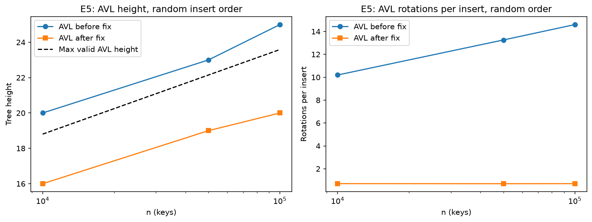

# INC-03: "AVL rotations update heights in the wrong order, causing excess rotations and over-tall trees">

## Summary

AVL inserts did 8–15 rotations each instead of at most one rebalance, and random-order trees grew taller than any valid AVL tree can be (height 25 at n = 100,000, when the limit is 23.6). Both rotation functions updated the new parent's height before its child's, so heights were stored wrong and caused extra rebalancing. Swapping two lines in each rotation fixed it, and random-order builds became about 2× faster.

## Detection

E1 (`31da8dc`, `0dd46d8`) first showed the problem in the rotation counter: rotations per insert grew with n (6.4 at 1,000, 9.6 at 10,000, 13.0 at 114,000). A correct AVL tree does at most one rebalance per insert, so a count that keeps growing was suspicious. The E5 figure (`analysis/figures/INC03_E5_before_after.png`) confirmed it: random-order trees were taller than the AVL limit at every size, which a correct AVL tree can never be.

## Expected vs. observed

Expected: search and insert are O(log n), with at most one single or double rotation per insert (at most 2n rotations total). Height should be at most 1.44·log₂(n + 2) − 0.33, which is 18.8, 22.1, and 23.6 for n = 10,000, 50,000, and 100,000.

Observed: rotations per insert grew from 6.4 at n = 1,000 to 13.0 at n = 114,000 (E1). In E5 (`e738e1e`, random order), heights were 20, 23, and 25, all above the limit, with 10.2, 13.3, and 14.6 rotations per insert. Nearly sorted keys reached height 28 at n = 100,000.

## Evidence

E5 AVL builds, `code_version` `e738e1e` (before) and `684e1a6` (after). Height (in nodes) is from `structure_info()`; rotations are from the rotation counter. Rotations and build time are medians of 5 replicates.

| n | order | height before | height after | rotations/insert before | rotations/insert after | build ms before | build ms after |
|---|---|---|---|---|---|---|---|
| 10,000 | random | 20 | 16 | 10.20 | 0.70 | 87.6 | 49.3 |
| 10,000 | sorted | 17 | 14 | 8.64 | 1.00 | 66.7 | 52.8 |
| 10,000 | nearly_sorted | 20 | 16 | 8.40 | 1.21 | 75.1 | 55.2 |
| 50,000 | random | 23 | 19 | 13.26 | 0.70 | 566.9 | 289.7 |
| 50,000 | sorted | 20 | 16 | 10.53 | 1.00 | 405.4 | 313.6 |
| 50,000 | nearly_sorted | 23 | 18 | 9.75 | 1.19 | 448.4 | 335.9 |
| 100,000 | random | 25 | 20 | 14.60 | 0.70 | 1224.1 | 653.0 |
| 100,000 | sorted | 21 | 17 | 11.39 | 1.00 | 891.9 | 655.7 |
| 100,000 | nearly_sorted | 28 | 20 | 10.30 | 1.20 | 938.1 | 726.5 |

Reversed order gave the same results as sorted order (it's a mirror image), so it isn't shown.



*Left: tree height. Before the fix, the tree was taller than any valid AVL tree can be (dashed line); after the fix, it's below that limit. Right: rotations per insert grew with n before the fix and stay at about 0.7 after.*

Small examples (`analysis/evidence/INC03_before.txt`, `INC03_after.txt`). Inserting 1–7 in order took 5 rotations and made a tree of height 4. A correct AVL tree takes 4 rotations and has height 3. Inserting 10, 20, 30 gave the root a recorded height of 4, but its real height is 2.


## Root cause

`indexes/avl_tree.py`, in `_rotate_right` (lines 62–63) and `_rotate_left` (lines 80–81): the two `_update_height` calls at the end of each function were in the wrong order.

A node's height depends on its children's heights. So after a rotation, the node that moved down must be updated first, then the node that moved up. The code did the opposite. It updated the new parent while its child still had its old, larger height, so the parent got a height that was too big.

Example: inserting 10, 20, 30 makes a chain where node 10 has height 3. `_rotate_left(10)` makes 20 the root, then updates 20 using 10's old height: 1 + max(3, 1) = 4. Node 10 is then fixed to 1, but 20 keeps 4. Its real height is 2.

Why searches were still correct but slow: the rotations moved the nodes correctly, so the tree was still a valid binary search tree and every search found the right answer. But the code decides when to rebalance using the recorded heights. Wrong heights made balanced parts of the tree look unbalanced, which caused extra rotations. These made the tree taller, so every operation needed more comparisons.

## Fix

Swapped the two `_update_height` calls in each rotation so the lower node is updated first. Commit `684e1a6`.

```diff
diff --git a/indexes/avl_tree.py b/indexes/avl_tree.py
index bef0b73..c376556 100644
--- a/indexes/avl_tree.py
+++ b/indexes/avl_tree.py
@@ -59,8 +59,8 @@ class AVLTreeIndex(Index):
         y.left = x.right
         x.right = y
         # x and y swapped places; refresh their stored heights.
-        _update_height(x)
         _update_height(y)
+        _update_height(x)
         self.stats.rotations += 1
         return x
 
@@ -77,8 +77,8 @@ class AVLTreeIndex(Index):
         x.right = y.left
         y.left = x
         # x and y swapped places; refresh their stored heights.
-        _update_height(y)
         _update_height(x)
+        _update_height(y)
         self.stats.rotations += 1
         return y
```

## Verification

Same E5 workload and seeds, `code_version` `e738e1e` (before) vs. `684e1a6` (after).Random-order heights dropped to 16, 19, and 20, all below the limits of 18.8, 22.1, and 23.6. Sorted input at n = 10,000 reached height 14, the lowest possible.Rotations per insert dropped from 8–15 to 0.70 (random) and 1.00 (sorted or reversed). Builds got 21–49% faster. Random order went from 567 to 290 ms at n = 50,000 (about 2×) and from 1,224 to 653 ms at n = 100,000 (about 1.9×). The small examples are now correct: 4 rotations and height 3 for keys 1–7, and root height 2 for 10, 20, 30. `make test`: 168 passed, 3 skipped (same as before).


## Impact on recommendations

Yes, it could have. The bug never caused wrong answers, but it made AVL look slower than it really is. It mainly affects F4 (catalog import), where builds were up to about 2× slower. It also affects F1–F3, because taller trees mean more comparisons per lookup. Unlike the hash table, AVL keeps keys in sorted order, so it can handle F2 (prefix search) and F3 (range queries), and the bug made it look like a weaker choice there than it is. With the fix, AVL is a real option for F2 and F3, and our final recommendations use the fixed code.

## Why the tests didn't catch it

The tests only check that searches return the right values, and an unbalanced tree still does. Tests that check the tree's structure would catch it. After random inserts, check that each node's recorded height matches the height calculated from its children, the height is at most 1.45·log₂(n + 2) or slightly above the true limit to allow some slack, and the total number of rotations is at most 2n.

