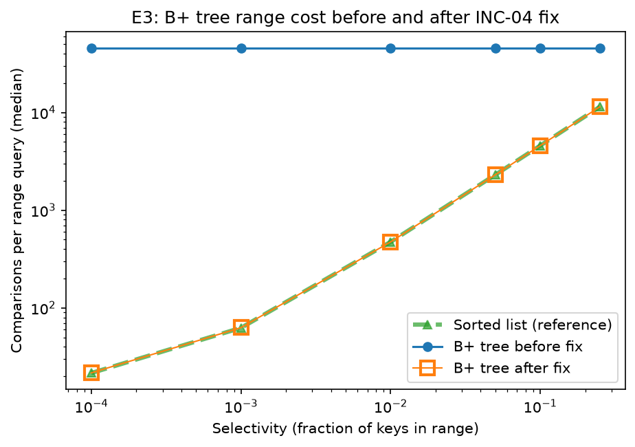

# INC-04: B+ tree range and prefix queries scan every leaf

## Summary

B+ tree range and prefix queries checked every key in the tree, no matter how small the range was. At selectivity 0.0001, a range query took 1,881 µs instead of 4 µs (470× slower). `range_search` searched every branch of the tree instead of going straight to the first matching leaf. Rewriting it to go down once and then walk the linked leaves fixed both range and prefix search.

## Detection

E3 (`0dd46d8`) first showed the problem: B+ tree range cost was the same at every selectivity, 45,653 comparisons and 2,197 nodes per query, while the sorted list and AVL tree got cheaper as ranges got narrower. The flat "before" line in the E3 figure (`analysis/figures/INC04_E3_before_after.png`) shows this. A range query should cost less when it returns less, so a flat cost was suspicious. E4 showed the same flat cost for prefix search, and E6 showed nodes visited always equaled the total number of leaves.

## Expected vs. observed

Expected: O(log n + matches). A range query should go down the tree once (about log n nodes) and then read only the leaves that hold matching keys.

Observed: O(n). Every range query cost 45,653 comparisons (one per key in the tree) and 2,197 nodes (every leaf), from selectivity 0.0001 to 0.25 (E3). Every prefix query cost 72,396 comparisons and 3,497 nodes at every prefix length (E4). In E6, nodes visited equaled the full leaf count at every order: 53,242 at order 3, 2,197 at order 32, and 131 at order 512.

## Evidence

Medians of 5 replicates. Comparisons and nodes visited are from the counters; leaf counts are from `structure_info()`.

E3 range queries, `code_version` `5be54e9` (before) and `e4a0cfb` (after):

| selectivity | comparisons before | comparisons after | nodes before | nodes after | µs before | µs after |
|---|---|---|---|---|---|---|
| 0.0001 | 45,653 | 21.6 | 2,197 | 4.2 | 1,881 | 4.0 |
| 0.25 | 45,653 | 11,430 | 2,197 | 529 | 2,737 | 2,789 |

E4 prefix queries, `code_version` `f24508f` (before) and `e4a0cfb` (after):

| prefix length | 1 | 2 | 3 | 4 | 5 |
|---|---|---|---|---|---|
| comparisons before | 72,396 | 72,396 | 72,396 | 72,396 | 72,396 |
| comparisons after | 3,180 | 616 | 195 | 175 | 41 |

E6 range queries at selectivity 0.01, `code_version` `e738e1e` (before) and `e4a0cfb` (after):

| order | comparisons before | comparisons after | nodes before | nodes after | µs before | µs after |
|---|---|---|---|---|---|---|
| 3 | 45,653 | ~474 | 53,242 | 318 | 20,334 | 200 |
| 512 | 45,653 | ~474 | 131 | 3.3 | 1,399 | 120 |



*Comparisons per range query by selectivity. Before the fix, the cost was flat at 45,653 no matter the range size. After the fix, it grows with the range size and matches the sorted list.*

Small example (`analysis/evidence/INC04_before.txt`, `INC04_after.txt`): in a 1,000-key tree (order 4), ranges 0–10, 500–510, and 980–990 each returned the correct 11 results but cost 1,000 comparisons and 751 nodes, the whole tree.

## Root cause

`indexes/bplus_tree.py`, `range_search` (line 173) and `_collect_range` (lines 179–190). `prefix_search` in `indexes/base.py` (line 102) calls `range_search`, so prefix search had the same bug.

What it did: `_collect_range` started at the root and went into every child, without checking whether that child could hold keys in the range. It reached every leaf and compared every key to `lo` and `hi`.

What it should do: go down the tree once to the leaf where `lo` belongs, then walk right through the linked leaves and stop at the first key greater than `hi`. Leaf keys are sorted across the whole chain, so once one key is past `hi`, every later key is too.

Why answers were correct but slow: it kept only keys with `lo ≤ key ≤ hi`, so it returned exactly the right values. But it checked all n keys on every query, O(n) instead of O(log n + matches).

## Fix

Rewrote `range_search` to call `_find_leaf(lo)`, find the first key ≥ `lo` with `_bisect_left`, then walk forward through the leaves using `next`, stopping at the first key greater than `hi`. Removed `_collect_range`. Commit `e4a0cfb`.

```diff
diff --git a/indexes/bplus_tree.py b/indexes/bplus_tree.py
index 7005649..e4c4d4c 100644
--- a/indexes/bplus_tree.py
+++ b/indexes/bplus_tree.py
@@ -172,22 +172,26 @@ class BPlusTreeIndex(Index):
 
     def range_search(self, lo: Any, hi: Any) -> list[Any]:
         result: list[Any] = []
-        if lo <= hi:
-            self._collect_range(self._root, lo, hi, result)
+        if lo > hi:
+            return result
+        # Go down once to the leaf where lo belongs
+        leaf: Optional[_Leaf] = self._find_leaf(lo)
+        # Start at the first key >= lo within that leaf
+        i = self._bisect_left(leaf.keys, lo)
+        # Walk right through the linked leaves, stopping at the first key > hi
+        while leaf is not None:
+            while i < len(leaf.keys):
+                self.stats.comparisons += 1
+                if leaf.keys[i] > hi:
+                    return result
+                result.extend(leaf.values[i])
+                i += 1
+            leaf = leaf.next
+            if leaf is not None:
+                self.stats.nodes_visited += 1
+            i = 0
         return result
 
-    def _collect_range(self, node: _Node, lo: Any, hi: Any, out: list[Any]) -> None:
-        """Gather values for keys in [lo, hi] from the subtree under ``node``, in key order."""
-        self.stats.nodes_visited += 1
-        if isinstance(node, _Leaf):
-            for key, values in zip(node.keys, node.values):
-                if lo <= key <= hi:
-                    out.extend(values)
-            self.stats.comparisons += len(node.keys)
-            return
-        for child in node.children:
-            self._collect_range(child, lo, hi, out)
-
     # ------------------------------------------------------------------ structure
     def structure_info(self) -> dict[str, Any]:
         height = 1
```

## Verification

Same workloads and seeds, before vs. after (`e4a0cfb`):

- E3 (`5be54e9` vs. `e4a0cfb`): comparisons went from a constant 45,653 to 21.6 at selectivity 0.0001, growing with range size (474 at 0.01, 11,430 at 0.25). Queries were 470× faster at 0.0001, 15× at 0.01, and about 2× at 0.1. At 0.25 the times are equal, because copying about 28,000 results takes most of the time in both versions.
- E4 (`f24508f` vs. `e4a0cfb`): prefix comparisons went from a constant 72,396 to 41–3,180, falling as the prefix gets longer. Queries were 9× faster at length 1 and 720× faster at length 5. These comparisons nearly match the AVL tree's (3,179, 617, 196, 175, 41), which supports that the fixed B+ tree does the right amount of work.
- E6 (`e738e1e` vs. `e4a0cfb`): comparisons fell from 45,653 to about 474 at every order, and queries were 12–100× faster.
- Small example: the same 11 results per range, with 23–25 comparisons and 12 nodes instead of 1,000 and 751.
- `make test`: 168 passed, 3 skipped (same as before).

## Impact on recommendations

Yes. The bug made the B+ tree look like a poor choice for F2 (search-as-you-type) and F3 (workout mode), the two features it is designed for. Before the fix, a narrow range query was 470× slower than after, so we would have recommended the sorted list or AVL tree instead. F3's 10-BPM window is a narrow range, which is where the fix helps most. The bug also biased the E6 order choice: before the fix, bigger orders always looked better because they meant fewer leaves to scan. After the fix, range time is fairly flat (about 105–200 µs) across orders, with the lowest values around order 16–32. Our final recommendations use the fixed code.

## Why the tests didn't catch it

The tests only check that range and prefix queries return the right values, and scanning every key still does. A test that checks the work done would catch it. For example, build a 1,000-key tree, run a range query that matches about 10 keys, and check that it uses fewer than 50 comparisons and visits far fewer nodes than the tree has.
