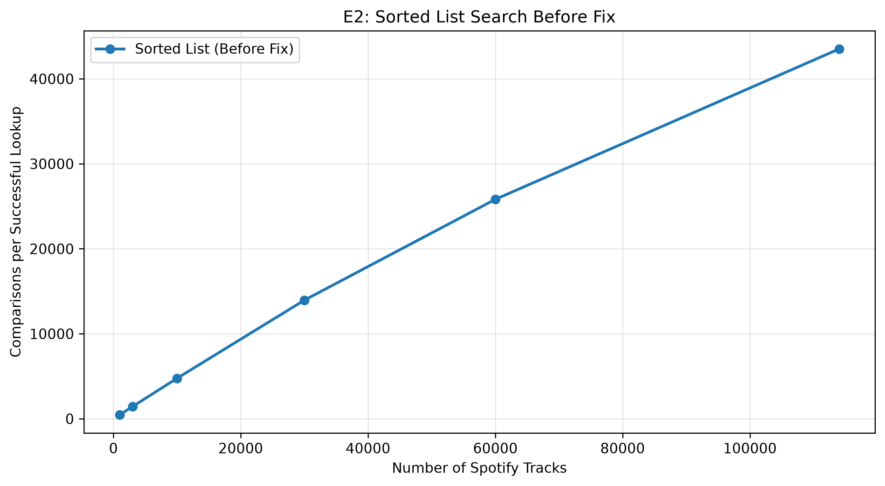

# INC-NN: <one-line title, e.g. "Hash table build cost grows with n">

Copy this file to `INC-01.md`, `INC-02.md`, … (one per bug) and fill in every section.
Keep each heading exactly as written; `make check` looks for them.

## Summary

Two or three sentences: what was slow, how much slower, which index and operation, and what fixed it.

Instead of using binary search, the sorted-list indext instead uses seqiuential key lookup to go through the track ids. The lookup takes 5,226 microseconds compared to the 1.06 microseconds of the hash table. The proposed fix is to use the 
bisect_left() to preform the binary search. 

## Detection

Which experiment and which figure first showed the problem? What made you suspicious?

The performance issue was discovered during Experiment E2 (E2_point_lookup), which measured how efficiently different index implementations searched for Spotify tracks. The sorted-list implementation showed an unexpectedly large number of comparisons as the dataset size increased.

At 1,000 tracks, the sorted list required approximately 466 comparisons per successful lookup. At 114,000 tracks, this increased to approximately 43,515 comparisons per lookup. Since a sorted list should support efficient binary search, this pattern suggested that the implementation was performing a linear search instead, which is unecessarily long and inefficient. 

## Expected vs. observed

What should this index cost, according to theory (big-O, and the counters you'd expect)?
What did you measure? Give numbers, e.g. "comparisons per lookup grew from X at n = 1,000 to Y at n = 114,000; theory predicts about log2(n)."

The sorted-list index should use binary search, which has a time complexity of O(log n). However, Experiment E2 showed that comparisons increased from approximately 466 per successful lookup at 1,000 tracks to 43,515 at 114,000 tracks. This suggests that searching is taking O(n) time rather than O(log n).

## Evidence

Figures and tables (exported from your notebook) that pin down the problem. Use the counters and
`structure_info()`, not only timings. Name the `code_version` of the rows you used.

The evidence comes from Experiment E2 using the Spotify track_id dataset. Each configuration was tested with 500 successful point lookups and five repetitions.

Original code_version: c2406c6

Original session_id: 26d932c399ee

Index: sorted_list

Operation: point_hit

Dataset sizes: 1,000–114,000 records

The results show that comparisons per lookup increased dramatically with the dataset size. At 114,000 records, the sorted list performed approximately 43,515 comparisons per successful lookup, compared with approximately 1.39 for the hash table and 16.90 for the AVL tree.

**Figure 1.** Median comparisons per successful lookup for the original sorted-list implementation in Experiment E2. The number of comparisons increases substantially as the dataset grows, suggesting linear-time searching rather than the expected logarithmic-time binary search.

## Root cause

File, function, and line numbers. Explain in plain English what the code does, what it should do,
and why the difference costs time but still gives correct answers.

The performance issue occurs in indexes/sorted_list.py, in the search() method (lines 48–60 of the original implementation). Instead of using the existing _bisect_left() binary-search helper, the method iterates through the sorted keys one at a time. Although it returns the correct results, this approach requires many unnecessary comparisons and makes searching slower as the dataset grows.

## Fix

The change you made, as a diff (`git diff <before>..<after> -- indexes/`), and the commit hash.

## Verification

Before/after comparison on the same workload and seeds (same experiment, two `code_version`s).
Confirm `make test` still passes.

## Impact on recommendations

Would this bug have changed which index you recommend for any feature (F1–F4)? How?

## Why the tests didn't catch it

What kind of test *would* catch a bug like this?
